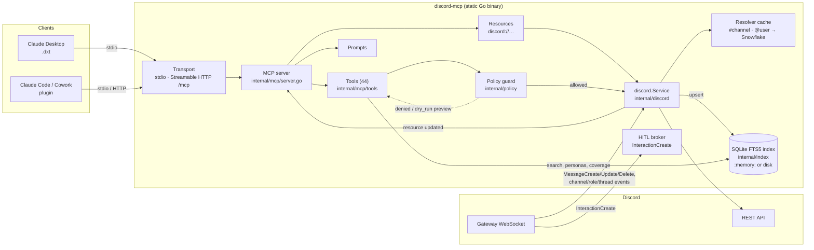
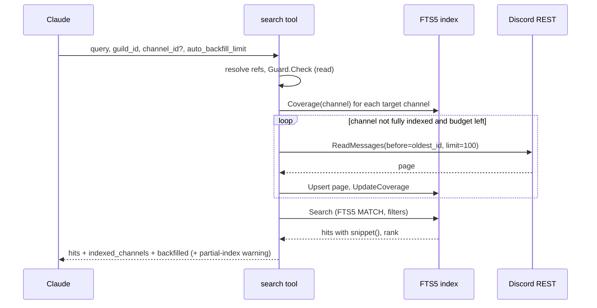
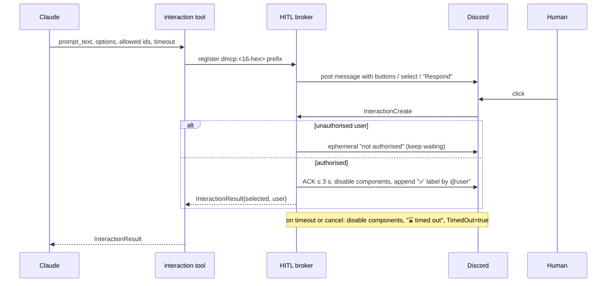

# Architecture

`discord-mcp` is a single static Go binary (`CGO_ENABLED=0`) that exposes
Discord to MCP clients over **stdio** or **Streamable HTTP** (`/mcp`). Every
tool call passes through a policy guard before it reaches the Discord service
layer, which wraps `discordgo` (REST + Gateway v10) and feeds an embedded
SQLite FTS5 index.

## Components

| Layer | Package | Responsibility |
| :--- | :--- | :--- |
| Entrypoint | `cmd/discord-mcp` | Flags/env config, logging (`slog` JSON → stderr), transport startup |
| Config | `internal/config` | flag > env > config file > default; multi-profile tokens via `token_env` |
| MCP | `internal/mcp` | Tool, resource-template, and prompt registration (`mcp-go`) |
| Policy | `internal/policy` | Read-only, allow/block lists, bulk-delete limits, dry-run previews |
| Discord | `internal/discord` | `Service` interface, `discordgo` client, resolver, rate-limit telemetry, HITL broker, mock client |
| Index | `internal/index` | FTS5 message store, channel coverage, personas, persona webhooks |
| DTOs | `internal/dto` | Token-compacted response types (snake_case, `omitempty`, string Snowflakes) |

## Request lifecycle

1. The client sends `tools/call` (JSON-RPC) over stdio or HTTP.
2. The tool handler validates parameters and resolves references
   (`#general`, `@alice`, `<#id>`, bare names) to Snowflakes via the resolver.
3. `Guard.Check(op)` evaluates rules in order: read-only → guild blocklist →
   guild allowlist → channel block/allowlist (threads also checked against the
   parent) → bulk limits → unresolvable scope. The first denial wins and is
   returned as a tool error (not a Go error).
4. If `dry_run: true`, the handler fetches cheap current state and returns a
   `DryRunPreview` — **zero mutating calls**.
5. Otherwise it calls `discord.Service`, which calls the REST API with
   rate-limit handling, and returns a compact DTO as JSON text.

## Data flows

### Search with lazy backfill (`discord_search_messages`)

- The Gateway keeps the index fresh in real time (`MessageCreate`/`Update`/`Delete`).
- `discord_read_messages` also upserts what it reads.
- Discord's `/guilds/{id}/messages/search` endpoint is never called (bots get 403).

### Human-in-the-loop (`discord_await_interaction`)

### Persona send (`discord_persona_send`)

1. Load the persona from the index (unknown → error listing registered personas).
2. Resolve the target: `channel_id` or the persona's default. For a thread,
   use the parent channel's webhook and pass `thread_id`.
3. Reuse the stored `persona_webhooks[parent]`, or create
   `discord-mcp personas` on the parent channel and store its ID and token.
4. Execute the webhook with `username = display_name` and the persona avatar.
   On `404 Unknown Webhook`, drop the row, recreate once, and retry.
5. The webhook token never appears in output or logs.

### Resource subscriptions

Clients may subscribe to `discord://channels/{id}/transcript` and
`discord://guilds/{id}/map`. Gateway events (`MessageCreate` for transcripts;
channel, role, or thread changes for maps) trigger
`notifications/resources/updated`, debounced to at most one per URI per 2 s.

## Security model

- **Secrets.** The bot token comes only from the environment (or an env var
  named by a profile's `token_env`); it is never logged or returned. Profile
  files with a literal `"token"` are rejected. Claude Desktop stores it as a
  `sensitive` user-config value; the plugin references `${DISCORD_BOT_TOKEN}`.
- **Webhook tokens** live only in the local index (`:memory:` by default; on
  disk the file is `0600` in a `0700` directory) and are never returned.
- **Stdout discipline.** stdout carries JSON-RPC frames only; all logs are
  structured JSON on stderr. `golangci-lint` (`forbidigo`) forbids
  `fmt.Print*` and `os.Stdout` outside `main.go`.
- **Least privilege.** `--read-only`, guild/channel allowlists and blocklists,
  and `dry_run` previews bound what a model can do; policy is enforced
  server-side before any API call. Dry runs are allowed even in read-only mode.
- **HTTP transport** binds `127.0.0.1:8080` by default with no built-in auth;
  expose it only behind an authenticating proxy.
- **HITL authorisation.** Only users in `allowed_user_ids` or with a role in
  `allowed_role_ids` can answer; timeouts are never treated as approval.
- **Personas** must be clearly bot/agent identities; the skills instruct Claude
  never to impersonate real members.
- **Supply chain.** Static `CGO_ENABLED=0 -trimpath` builds for four
  darwin/linux targets, SHA-256 `checksums.txt` covering tarballs and `.dxt`
  bundles, least-privilege CI permissions, and gitleaks scanning.
